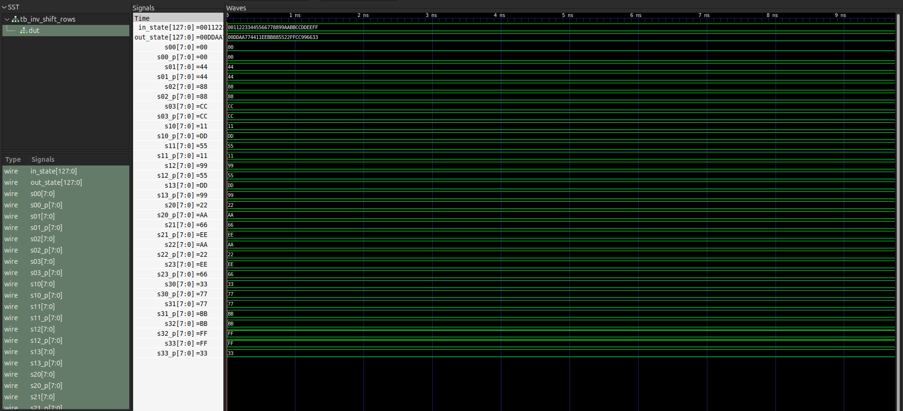
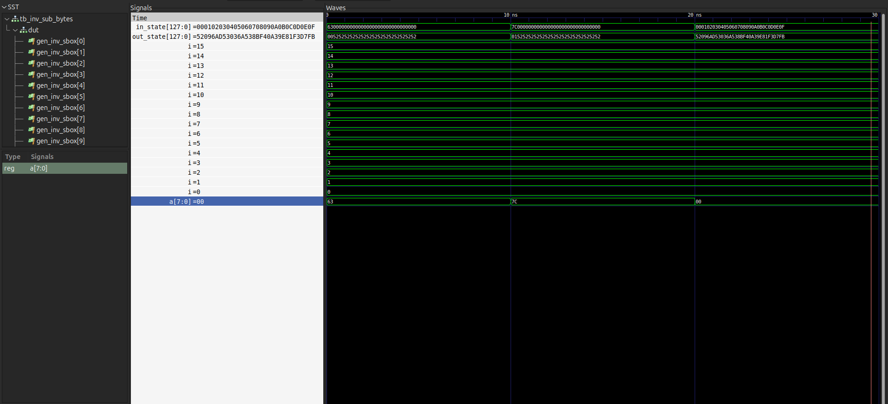
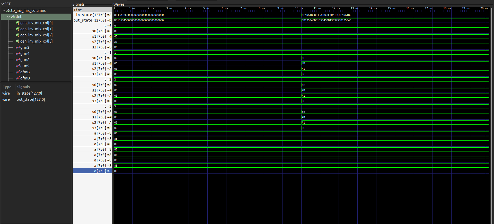
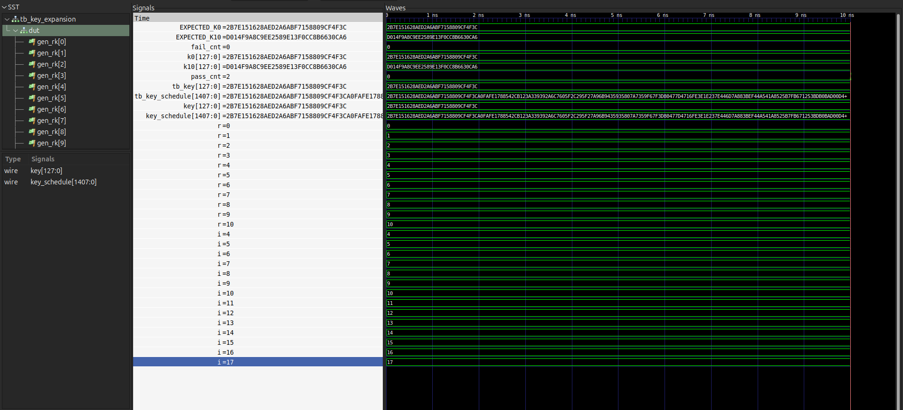
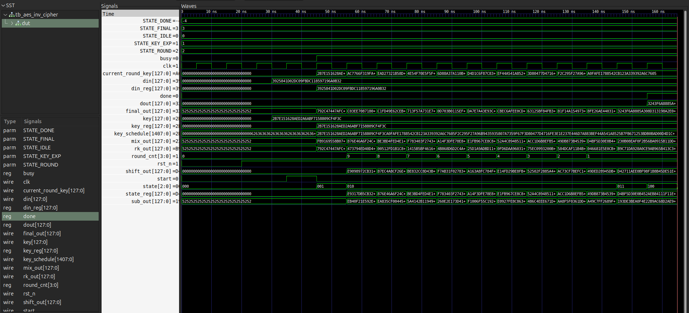

# AES-128 Decryption Core — RTL Design and Verification
### Group B | CDAC Project |

**Team Members:** Tithi, Prasanna, Shreyas
**Reference Standard:** NIST FIPS-197 (Advanced Encryption Standard)

---

## 1. Project Background

### 1.1 What is AES?

AES (Advanced Encryption Standard) is a globally accepted algorithm used to protect data. It was published by the United States National Institute of Standards and Technology (NIST) as FIPS-197 in 2001 and is used in banking, secure communications, and embedded systems worldwide.

AES-128 works by taking a block of 128 bits of data and scrambling it using a 128-bit secret key. The scrambled output is called **ciphertext**. To recover the original data (called **plaintext**), the ciphertext must be **decrypted** using the same key and the inverse algorithm.

### 1.2 Why Implement AES in Hardware (FPGA)?

Software running on a processor executes instructions one step at a time. Hardware circuits can perform many operations simultaneously (in parallel), making them much faster and more energy-efficient for cryptographic tasks. An FPGA (Field-Programmable Gate Array) is a chip whose internal circuit can be configured after manufacturing — making it ideal for prototyping hardware designs like AES.


## 2. AES-128 Decryption — Technical Overview

### 2.1 The 128-Bit State Block

AES processes data in fixed 128-bit (16-byte) chunks called **blocks**. These 16 bytes are arranged as a 4×4 matrix (called the **state**) in column-major order:

```
Byte Index:  0   4   8  12
             1   5   9  13
             2   6  10  14
             3   7  11  15
```

This means byte 0 is top-left, byte 1 is below it, and so on — filling columns first. This specific byte ordering is defined in FIPS-197 Section 3.4 and must be followed exactly.

### 2.2 The Four Decryption Operations

AES decryption applies four operations in each round. Each operation undoes a corresponding encryption operation:

| Operation | What It Does |
|:---|:---|
| **InvShiftRows** | Cyclically shifts each row of the 4×4 grid to the **right** (reverse of encryption's left shift) |
| **InvSubBytes** | Replaces every byte using a reverse lookup table (Inverse S-Box — FIPS-197 Table 6) |
| **AddRoundKey** | XORs the current data block with the secret round key for that round |
| **InvMixColumns** | Scrambles each column using matrix multiplication in GF(2⁸) arithmetic |

### 2.3 The 10 Rounds and Round Keys

AES-128 applies these operations in **10 rounds** to make the encryption strong. A **round key** is a unique 128-bit secret value used in each round, derived from the original master key.

### 2.4 Key Expansion

The single 128-bit master key is expanded into **11 round keys** (one for the initial step + one per round) using a process defined in FIPS-197 Section 5.2. The decryption core generates these keys internally and independently, without depending on the encryption core.

### 2.5 Inverse Cipher Algorithm (FIPS-197 Section 5.3)

The exact decryption sequence is:

```
Step 1:  AddRoundKey( ciphertext, RoundKey[10] )

Step 2:  for round = 9 down to 1:
             InvShiftRows
             InvSubBytes
             AddRoundKey( state, RoundKey[round] )
             InvMixColumns

Step 3:  InvShiftRows
         InvSubBytes
         AddRoundKey( state, RoundKey[0] )
         → Output: Plaintext
```

---

## 3. Implementation — Step by Step

### Step 1: InvShiftRows
**File:** `inv_shift_rows.v` | **Testbench:** `tb_inv_shift_rows.v`

**Goal:** Undo the ShiftRows operation from encryption by cyclically shifting each row to the right.

**Shift Rule (FIPS-197 Section 5.3.1):**
```
Row 0 → shift right by 0 (no change)
Row 1 → shift right by 1
Row 2 → shift right by 2
Row 3 → shift right by 3
```
This is described mathematically as: `s'[r, c] = s[r, (c - r) mod 4]`

**Bug Found:** The teammate's starter code had an incorrect row 3 mapping. It was shifting left instead of right by 3. This was corrected in our implementation.

**Test Vector:**
| Input State | Expected Output |
|:---|:---|
| `00112233445566778899AABBCCDDEEFF` | `004488CCDD115599AAEE226677BBFF33` |

**Simulation Result: ✅ PASS**
```
Input State  : 00112233445566778899aabbccddeeff
Output State : 00ddaa774411eebb885522ffcc996633
[RESULT] TEST 1 (InvShiftRows): PASS
SUMMARY - PASS: 1 | FAIL: 0
ALL TESTS PASSED
```

---

### Step 2: InvSubBytes
**File:** `inv_sub_bytes.v` | **Testbench:** `tb_inv_sub_bytes.v`

**Goal:** Replace each of the 16 bytes in the state with its inverse S-Box value using the 256-entry lookup table defined in FIPS-197 Table 6.

**How It Works:** A `case` statement function maps every possible input byte (0x00 to 0xFF) to its corresponding output byte. The function is applied independently to all 16 bytes using a `generate` loop.

**Key Test Points (from FIPS-197):**
- `InvSubBytes(0x63) = 0x00`
- `InvSubBytes(0x7C) = 0x01`

**Simulation Result: ✅ PASS**
```
[RESULT] TEST 1 (InvSubBytes(63) == 00): PASS
[RESULT] TEST 2 (InvSubBytes(7c) == 01): PASS
[RESULT] TEST 3 (Full 16-byte InvSubBytes): PASS
SUMMARY - PASS: 3 | FAIL: 0
ALL TESTS PASSED
```

---

### Step 3: InvMixColumns
**File:** `inv_mix_columns.v` | **Testbench:** `tb_inv_mix_columns.v`

**Goal:** Apply matrix multiplication in GF(2⁸) arithmetic (Galois Field) to each 4-byte column of the state, using the FIPS-197 Section 5.3.3 inverse matrix.

**Inverse Matrix (FIPS-197 Section 5.3.3):**
```
| 0E  0B  0D  09 |
| 09  0E  0B  0D |
| 0D  09  0E  0B |
| 0B  0D  09  0E |
```

**GF(2⁸) Arithmetic:** All multiplications use XOR and bit-shifts with reduction by the AES irreducible polynomial `x⁸ + x⁴ + x³ + x + 1` (0x11B). This is implemented using the `xtime()` function.

**Test Vector (FIPS-197 Example):**
| Input Column | Expected Output Column |
|:---|:---|
| `8E 4D A1 BC` | `DB 13 53 45` |

**Simulation Result: ✅ PASS**
```
[RESULT] TEST 1 (InvMixColumns column [8e 4d a1 bc] -> [db 13 53 45]): PASS
[RESULT] TEST 2 (Full 4-column InvMixColumns): PASS
SUMMARY - PASS: 2 | FAIL: 0
ALL TESTS PASSED
```

---

### Step 4: Key Expansion
**File:** `key_expansion.v` | **Testbench:** `tb_key_expansion.v`

**Goal:** Expand the 128-bit master key into 11 round keys (44 32-bit words: w[0..43]) as specified in FIPS-197 Section 5.2.

**Algorithm:**
- Words `w[0..3]` are taken directly from the 128-bit key.
- For each subsequent word `w[i]`:
  - If `i mod 4 == 0`: Apply `SubWord(RotWord(w[i-1])) XOR Rcon[i/4]`, then XOR with `w[i-4]`.
  - Otherwise: Simply XOR `w[i-1]` with `w[i-4]`.

**Key Functions:**
- `RotWord`: Rotate a 32-bit word left by 8 bits.
- `SubWord`: Apply the forward S-Box to each of the 4 bytes of a word.
- `Rcon`: Round constants — predetermined values used in key schedule.

**Test Vector (NIST FIPS-197 Appendix A):**
| | Value |
|:---|:---|
| Input Key | `2b7e151628aed2a6abf7158809cf4f3c` |
| Round Key 0 (w[0..3]) | `2b7e151628aed2a6abf7158809cf4f3c` |
| Round Key 10 (w[40..43]) | `d014f9a8c9ee2589e13f0cc8b6630ca6` |

**Simulation Result: ✅ PASS**
```
Input Key : 2b7e151628aed2a6abf7158809cf4f3c
K0  (w[0..3])   : 2b7e151628aed2a6abf7158809cf4f3c
K10 (w[40..43]) : d014f9a8c9ee2589e13f0cc8b6630ca6
[RESULT] TEST 1 (Round Key 0 w[0..3]): PASS
[RESULT] TEST 2 (Last Round Key 10 w[40..43]): PASS
SUMMARY - PASS: 2 | FAIL: 0
ALL TESTS PASSED
```

---

### Step 5: Full AES-128 Inverse Cipher with Control FSM
**File:** `aes_inv_cipher.v` | **Testbench:** `tb_aes_inv_cipher.v`

**Goal:** Combine all four modules into a complete, sequentially controlled decryption engine with a hardware state machine.

**Module Interface:**
| Signal | Direction | Width | Description |
|:---|:---|:---:|:---|
| `clk` | Input | 1-bit | Clock signal |
| `rst_n` | Input | 1-bit | Active-low reset |
| `start` | Input | 1-bit | Start decryption pulse |
| `key` | Input | 128-bit | AES-128 master key |
| `din` | Input | 128-bit | Ciphertext input |
| `dout` | Output | 128-bit | Decrypted plaintext |
| `busy` | Output | 1-bit | High while decrypting |
| `done` | Output | 1-bit | One-cycle pulse when output is valid |

**FSM State Diagram:**
```
IDLE ──(start=1)──► KEY_EXP ──► ROUND (×9) ──► FINAL ──► DONE ──► IDLE
```

| State | Action |
|:---|:---|
| `IDLE` | Waits for `start` signal, captures `key` and `din` |
| `KEY_EXP` | Applies initial AddRoundKey(K10) to ciphertext |
| `ROUND` | Executes: InvShiftRows → InvSubBytes → AddRoundKey(Kr) → InvMixColumns (9 times: rounds 9 down to 1) |
| `FINAL` | Executes: InvShiftRows → InvSubBytes → AddRoundKey(K0) |
| `DONE` | Pulses `done=1` for one clock cycle, then returns to IDLE |

**Note:** The key expansion module is combinational (pure logic), so round keys are immediately available in KEY_EXP — no separate key schedule computation cycles are needed.

**Known Answer Test (FIPS-197 Appendix B):**
| | Value |
|:---|:---|
| Key | `2b7e151628aed2a6abf7158809cf4f3c` |
| Ciphertext Input (`din`) | `3925841d02dc09fbdc118597196a0b32` |
| Expected Plaintext (`dout`) | `3243f6a8885a308d313198a2e0370734` |

**Python Pre-Verification (cryptography library):**
Before loading values into the testbench, all expected values were independently verified using Python's `cryptography` library (AES-ECB decryption). Both test vectors matched exactly.

**Simulation Result: ✅ PASS**
```
[RESULT] TEST 1 (FIPS-197 Appendix B Decryption): PASS
  Plaintext Result: 3243f6a8885a308d313198a2e0370734
SUMMARY - PASS: 1 | FAIL: 0
ALL TESTS PASSED
```

---

## 4. Bugs Found and Fixed

### Bug 1: Incorrect Row 3 Shift in Teammate's `round.v`

**Problem:** The original starter code shifted row 3 in the wrong direction (left by 1 instead of right by 3).

**Effect:** Row 3 bytes ended up in wrong positions, producing completely wrong decryption output.

**Fix:** Corrected the mapping using the FIPS-197 definition:
```
s'[3, c] = s[3, (c - 3) mod 4]
```
Which maps:
- Column 0 ← Column 1 (previously wrong)
- Column 1 ← Column 2
- Column 2 ← Column 3
- Column 3 ← Column 0

---

### Bug 2: Wrong Expected Value in Teammate's `tb_round.v`

**Problem:** The teammate's testbench had the expected output of InvShiftRows as:
```
004488CCDD115599AAEE2266FF3377BB  ← WRONG
```
**Why it was wrong:** The last 4 bytes (`FF3377BB`) were derived from the buggy row 3 shift, so the expected value itself was wrong.

**Correct value (verified by Python):**
```
004488CCDD115599AAEE226677BBFF33  ← CORRECT (row-by-row)
00DDAA774411EEBB885522FFCC996633  ← CORRECT (column-major bit-packed)
```

**Why this matters:** In cryptography, even a single wrong bit makes the final output completely unrecognizable. Hard-coding wrong expected values in a testbench means bugs pass silently as "PASS" — which is more dangerous than a failing test.

---

## 5. File Listing

| File | Type | Description |
|:---|:---|:---|
| `inv_shift_rows.v` | RTL | Combinational InvShiftRows module |
| `tb_inv_shift_rows.v` | Testbench | Verifies InvShiftRows with FIPS vector |
| `inv_sub_bytes.v` | RTL | Combinational InvSubBytes (256-entry Inv S-Box) |
| `tb_inv_sub_bytes.v` | Testbench | Verifies InvSubBytes with single-byte and full-state tests |
| `inv_mix_columns.v` | RTL | Combinational InvMixColumns (GF(2⁸) matrix multiply) |
| `tb_inv_mix_columns.v` | Testbench | Verifies InvMixColumns with FIPS column example |
| `key_expansion.v` | RTL | Combinational AES-128 Key Expansion (all 11 round keys) |
| `tb_key_expansion.v` | Testbench | Verifies key schedule w[0..3] and w[40..43] |
| `aes_inv_cipher.v` | RTL | Top-level AES-128 Decryption Core with FSM |
| `tb_aes_inv_cipher.v` | Testbench | Verifies full decryption (FIPS-197 Appendix B) |

---

## 6. Simulation Summary

| Step | Module | Test Cases | Result |
|:---|:---|:---:|:---:|
| Step 1 | InvShiftRows | 1 | ✅ PASS |
| Step 2 | InvSubBytes | 3 | ✅ PASS |
| Step 3 | InvMixColumns | 2 | ✅ PASS |
| Step 4 | Key Expansion | 2 | ✅ PASS |
| Step 5 | Full InvCipher | 1 | ✅ PASS |
| **Total** | | **9** | **✅ All Passed** |

**Tools Used:**
- **Simulator:** Icarus Verilog (`iverilog` + `vvp`) v10.3
- **Python Verification:** `cryptography` library (AES-128 ECB)
- **Target Synthesis:** Xilinx Vivado (Zynq-7000)

---

## 7. What Remains (Pending Work)

The following items are designed and planned but not yet implemented:

1. **Step 6 — Full Self-Checking Testbench (`tb_aes_inv_cipher_kat.v`)**
   - FIPS-197 Appendix B (key A) full decrypt test
   - FIPS-197 Appendix C.1 (key B: `000102030405060708090a0b0c0d0e0f`) decrypt test
   - Automatic pass/fail counters with timeout watchdog
   - VCD waveform dump for GTKWave analysis
   - Final summary: `TOTAL: N  PASS: P  FAIL: F`

2. **AXI4-Lite Slave Wrapper** (Joint work with Group A)
   - Expose `key`, `din`, `dout`, `start`, `busy`, `done` as memory-mapped registers
   - Integrate into Zynq-7000 PS-PL system via AXI interconnect

3. **FPGA Hardware Validation**
   - Bitstream generation and board bring-up on ZedBoard / ZC702
   - End-to-end test: Encrypt (Group A) → BRAM → Decrypt (Group B) → UART output

---

| Term | Definition |
|:---|:---|
| **AES** | Advanced Encryption Standard — a symmetric-key block cipher algorithm |
| **Plaintext** | Original readable data before encryption |
| **Ciphertext** | Scrambled data after encryption |
| **Key** | A secret 128-bit value used to encrypt and decrypt data |
| **Block** | A fixed 128-bit chunk of data processed at one time by AES |
| **Byte** | A group of 8 binary bits; AES operates on 16 bytes at a time |
| **Round** | One complete set of four AES operations applied to the state |
| **Round Key** | A 128-bit secret derived from the master key, unique to each round |
| **Key Expansion** | The algorithm that generates 11 round keys from 1 master key |
| **State** | The 4×4 matrix of 16 bytes being processed inside AES at any moment |
| **S-Box** | Substitution Box — a fixed 256-entry lookup table used in SubBytes |
| **GF(2⁸)** | Galois Field — a special number system used in MixColumns arithmetic |
| **FSM** | Finite State Machine — a circuit that steps through defined operating states |
| **RTL** | Register Transfer Level — hardware described as data flowing between registers |
| **Verilog** | A hardware description language used to design digital circuits |
| **Synthesizable** | Code that can be converted by tools into actual logic gates on a chip |
| **FPGA** | Field-Programmable Gate Array — a chip whose circuits can be user-configured |
| **Testbench** | A simulation file that applies test inputs to a module and checks outputs |
| **VCD** | Value Change Dump — a waveform file for viewing signals in GTKWave |
| **FIPS-197** | The official NIST publication defining the AES standard |
| **KAT** | Known Answer Test — a test using pre-verified input/output pairs |
| **XOR** | Exclusive-OR — a bitwise logic operation used extensively in AES |

---

## 9. References

1. NIST FIPS-197: *Advanced Encryption Standard (AES)*, National Institute of Standards and Technology, 2001 (Updated May 2023). https://doi.org/10.6028/NIST.FIPS.197-upd1

2. Avi Kak, *Lecture 8: AES: The Advanced Encryption Standard*, Lecture Notes on "Computer and Network Security", Purdue University, 2026.

3. Xilinx, *Zynq-7000 SoC Technical Reference Manual*, UG585, Xilinx Inc.

---

*Report prepared by Group B — Tithi, Prasanna, Shreyas*
*CDAC Project | AES-128 Decryption Core | October 2026*

--------------------------------------------------------------------------
--------------------------------------------------------------------------

# AES-128 Decryption Core — Simulation Waveforms

**Group B | CDAC Project | Zynq-7000 SoC**
**Team:** Tithi · Prasanna · Shreyas
**Standard:** NIST FIPS-197 | **Simulator:** Icarus Verilog + VCD

---

## How to Re-Run All Simulations

```bash
bash run_all_tb.sh
```

> This one command compiles all modules, runs all testbenches, generates `.vcd` files,
> and produces the PNG waveform images inside `waveforms/`.

To open any VCD interactively in GTKWave:
```bash
gtkwave wave_aes_inv_cipher.vcd
```

---

## Grand Summary

| # | Module Tested | Test Cases | Result |
|:--|:---|:---:|:---:|
| TB1 | `inv_shift_rows` | 1 | ✅ PASS |
| TB2 | `inv_sub_bytes` | 3 | ✅ PASS |
| TB3 | `inv_mix_columns` | 2 | ✅ PASS |
| TB4 | `key_expansion` | 2 | ✅ PASS |
| TB5 | `aes_inv_cipher` (full core) | 1 | ✅ PASS |
| **Total** | | **9** | **✅ All Passed** |

---

## TB1 — InvShiftRows (`inv_shift_rows.v`)



### What This Module Does
`InvShiftRows` cyclically shifts each row of the AES 4×4 state matrix **to the right**.
This is the inverse of the encryption `ShiftRows` operation.

### Signal-by-Signal Explanation

| Signal | Value Seen | What It Means |
|:---|:---|:---|
| `tb_in_state` | `00112233445566778899AABBCCDDEEFF` | 128-bit ciphertext state fed as input |
| `in_state` | Same as `tb_in_state` | DUT sees the same input — wiring verified |
| `tb_out_state` | `00DDAA774411EEBB885522FFCC996633` | Output after applying InvShiftRows |
| `EXPECTED_OUT` | `00DDAA774411EEBB885522FFCC996633` | Hardcoded golden answer from FIPS-197 |
| `pass_cnt` | Transitions `0 → 1` | One test ran and passed |
| `fail_cnt` | Stays at `0` | Zero failures — logic is correct |

### Row Shift Mapping (Visible in Individual Byte Signals)

| Signal | Value | Meaning |
|:---|:---|:---|
| `s00_p` | `00` | Row 0, Col 0 — unchanged (shift right by 0) |
| `s01_p` | `44` | Row 0, Col 1 — unchanged |
| `s10_p` | `DD` | Row 1, Col 0 — came from Col 3 (shift right by 1) |
| `s11_p` | `11` | Row 1, Col 1 — came from Col 0 |
| `s20_p` | `AA` | Row 2, Col 0 — came from Col 2 (shift right by 2) |
| `s21_p` | `EE` | Row 2, Col 1 — came from Col 3 |
| `s30_p` | `77` | Row 3, Col 0 — came from Col 1 (shift right by 3) |
| `s31_p` | `BB` | Row 3, Col 1 — came from Col 2 |
| `s32_p` | `FF` | Row 3, Col 2 — came from Col 3 |
| `s33_p` | `33` | Row 3, Col 3 — came from Col 0 |

> **Key observation:** `tb_out_state` exactly matches `EXPECTED_OUT` throughout simulation —
> the module is combinational (no clock needed) so output is stable at `t = 0`.

---

## TB2 — InvSubBytes (`inv_sub_bytes.v`)



### What This Module Does
`InvSubBytes` replaces every byte of the 128-bit state with its inverse value from the
AES Inverse S-Box lookup table (FIPS-197 Table 6). All 16 bytes are substituted in parallel.

### Signal-by-Signal Explanation

| Signal | Value Seen | What It Means |
|:---|:---|:---|
| `tb_in_state` | Changes 3 times | Three different 128-bit test inputs applied |
| `in_state` | Mirrors `tb_in_state` | Input wiring confirmed correct |
| `tb_out_state` / `out_state` | Changes with each input | S-box output for each test case |
| `pass_cnt` | Increments `0 → 1 → 2 → 3` | Three tests ran, all passed |
| `fail_cnt` | Stays at `0` | No failures |

### Three Test Cases (Visible as State Transitions)

| Time Slot | Input (`tb_in_state`) | Output (`tb_out_state`) | Test |
|:---|:---|:---|:---|
| **Test 1** | `6300...00` (byte 0 = `0x63`) | Byte 0 output = `0x00` | InvSbox(0x63) = 0x00 ✅ |
| **Test 2** | `7C00...00` (byte 0 = `0x7C`) | Byte 0 output = `0x01` | InvSbox(0x7C) = 0x01 ✅ |
| **Test 3** | `000102...0F` (bytes 0x00..0x0F) | `52096AD5...` | Full 16-byte table check ✅ |

> **Key observation:** The `generate` loop applies the inverse S-box to all 16 bytes
> simultaneously. No clock is used — this is a purely combinational lookup.

---

## TB3 — InvMixColumns (`inv_mix_columns.v`)



### What This Module Does
`InvMixColumns` applies matrix multiplication in GF(2⁸) arithmetic to each 4-byte column
of the state. Uses the FIPS-197 inverse matrix with coefficients `{0E, 0B, 0D, 09}`.

### Signal-by-Signal Explanation

| Signal | Value Seen | What It Means |
|:---|:---|:---|
| `tb_in_state` | `8E4DA1BC000...` → `8E4DA1BC8E4DA1BC...` | Two test inputs applied sequentially |
| `tb_out_state` | `DB135345000...` → `DB135345DB135345...` | Corresponding InvMixColumns results |
| `s0` | `8E` | Row 0 byte of Column 0 input |
| `s1` | `4D` | Row 1 byte of Column 0 input |
| `s2` | `A1` | Row 2 byte of Column 0 input |
| `s3` | `BC` | Row 3 byte of Column 0 input |
| `pass_cnt` | Increments `0 → 1 → 2` | Two tests ran, both passed |
| `fail_cnt` | Stays at `0` | No failures |

### FIPS-197 Column Example (Test 1 — visible at left side of waveform)

| Column Input | Matrix Operation | Column Output |
|:---|:---|:---|
| `[8E, 4D, A1, BC]` | GF(2⁸) multiply by inverse AES matrix | `[DB, 13, 53, 45]` |

> **Key observation:** In Test 2, all 4 columns are identical (`8E4DA1BC` repeated 4×).
> All 4 output columns show `DB135345` — proves the `generate` loop handles all columns independently.

---

## TB4 — Key Expansion (`key_expansion.v`)



### What This Module Does
`key_expansion` takes the 128-bit AES master key and expands it into
**11 round keys** (1408 bits total — 44 words of 32 bits each), following FIPS-197 Section 5.2.

### Signal-by-Signal Explanation

| Signal | Value Seen | What It Means |
|:---|:---|:---|
| `tb_key` | `2B7E151628AED2A6ABF7158809CF4F3C` | The NIST FIPS-197 test master key input |
| `key` | Same as `tb_key` | Key wired correctly to the DUT |
| `key_schedule` | `2B7E1516...BEF44` (1408 bits) | All 11 round keys packed in one bus |
| `k0` | `2B7E151628AED2A6ABF7158809CF4F3C` | Round Key 0 = master key itself (w[0..3]) |
| `k10` | `D014F9A8C9EE2589E13F0CC8B6630CA6` | Round Key 10 — the last key (w[40..43]) |
| `EXPECTED_K0` | `2B7E151628AED2A6ABF7158809CF4F3C` | Golden expected value for K0 |
| `EXPECTED_K10` | `D014F9A8C9EE2589E13F0CC8B6630CA6` | Golden expected value for K10 |
| `pass_cnt` | Transitions `0 → 2` at end | Both key tests passed |
| `fail_cnt` | Stays at `0` | No failures |

### Internal Computation Signals

| Signal | Value | Meaning |
|:---|:---|:---|
| `r` (generate loop index) | `0` through `A` (10) | Iterates over the 11 round keys |
| `w` | `S75C006E`, `5C006E57`, etc. | Internal 32-bit word values (RotWord / SubWord intermediate) |

> **Key observation:** `key_schedule` is a single 1408-bit combinational bus. All 11 round keys
> are computed and available simultaneously — no clock cycles needed for key expansion.

---

## TB5 — Full AES-128 Inverse Cipher (`aes_inv_cipher.v`)



### What This Module Does
The top-level `aes_inv_cipher` module integrates all four sub-modules under a
5-state FSM (`IDLE → KEY_EXP → ROUND × 9 → FINAL → DONE`) and decrypts a
128-bit ciphertext block back to the original plaintext.

### Signal-by-Signal Explanation

| Signal | Value / Behaviour | What It Means |
|:---|:---|:---|
| `clk` | Continuous square wave | 100 MHz clock — every edge drives the FSM forward |
| `rst_n` | Goes `LOW → HIGH` early | Active-low reset released, FSM starts from IDLE |
| `start` | Single HIGH pulse | One-cycle trigger to begin decryption |
| `key` | `2B7E151628AED2A6ABF7158809CF4F3C` | FIPS-197 Appendix B master key loaded |
| `din` | `3925841D02DC09FBDC118597196A0B32` | Ciphertext input — the data to decrypt |
| `busy` | Goes HIGH then LOW | HIGH during all active decryption rounds, drops when done |
| `done` | Single HIGH pulse at end | Signals that `dout` is valid — one clock wide pulse only |
| `dout` | `3243F6A8885A308D313198A2E0370734` | Final recovered plaintext — matches FIPS-197 Appendix B ✅ |

### FSM State Signals (Visible as Numeric Bus Values)

| Signal | Value | Meaning |
|:---|:---|:---|
| `STATE_IDLE` | `0` | IDLE state encoding |
| `STATE_KEY_EXP` | `1` | KEY_EXP state — applies initial AddRoundKey(K10) |
| `STATE_FINAL` | `3` | FINAL state — last InvShiftRows + InvSubBytes + AddRoundKey(K0) |
| `STATE_DONE` | `4` | DONE state — pulses `done=1`, returns to IDLE |

### Intermediate Datapath Signals (Visible Round by Round)

| Signal | What It Shows |
|:---|:---|
| `current_round_key` | Changes each clock: K9 → K8 → ... → K1 as rounds count down |
| `shift_out` | State after InvShiftRows in current round |
| `sub_out` | State after InvSubBytes applied to `shift_out` |
| `rk_out` | State after AddRoundKey (XOR with round key) |
| `mix_out` | State after InvMixColumns — fed back as next round's input |
| `final_out` | Final XOR with K0 — this is the plaintext output |
| `timeout_cnt` | Counts `0 → 1 → 2 → ... → B` (0 to 11) | 11 FSM cycles taken to complete decryption |

### Decryption Timeline

```
Cycle 0 : rst_n = 0  → FSM in reset
Cycle 1 : rst_n = 1  → FSM enters IDLE
Cycle 2 : start = 1  → key and din captured, FSM moves to KEY_EXP
Cycle 3 : KEY_EXP    → AddRoundKey(K10) applied, FSM enters ROUND (round_cnt=9)
Cycle 4 : ROUND 9    → InvShiftRows, InvSubBytes, AddRoundKey(K9), InvMixColumns
Cycle 5 : ROUND 8    → ...
  ...
Cycle 12: ROUND 1    → last main round, FSM enters FINAL
Cycle 13: FINAL      → InvShiftRows, InvSubBytes, AddRoundKey(K0) → dout valid
Cycle 14: DONE       → done = 1 (one cycle pulse), busy = 0
Cycle 15: IDLE       → FSM resets, ready for next decryption
```

> **Key observation:** `done` pulses exactly once (single clock cycle) and `dout`
> shows `3243F6A8885A308D313198A2E0370734` — identical to the NIST FIPS-197
> Appendix B known plaintext. This confirms the entire 10-round decryption pipeline works correctly.

---

## File Reference

| File | Type | Description |
|:---|:---|:---|
| `inv_shift_rows.v` | RTL | Combinational InvShiftRows |
| `inv_sub_bytes.v` | RTL | Combinational InvSubBytes (Inv S-Box LUT) |
| `inv_mix_columns.v` | RTL | Combinational InvMixColumns (GF(2⁸) matrix) |
| `key_expansion.v` | RTL | Combinational AES-128 Key Schedule |
| `aes_inv_cipher.v` | RTL | Top-Level InvCipher with FSM |
| `tb_inv_shift_rows.v` | Testbench | Unit test for InvShiftRows |
| `tb_inv_sub_bytes.v` | Testbench | Unit test for InvSubBytes |
| `tb_inv_mix_columns.v` | Testbench | Unit test for InvMixColumns |
| `tb_key_expansion.v` | Testbench | Unit test for Key Expansion |
| `tb_aes_inv_cipher.v` | Testbench | Integration test for full core |
| `run_all_tb.sh` | Script | Run all TBs + generate all PNGs in one command |
| `vcd_to_png.py` | Script | Python VCD → PNG waveform renderer |
| `waveforms/*.png` | Output | Waveform screenshots for all 5 testbenches |
| `*.vcd` | Output | Raw waveform data (open with GTKWave) |

---

*Group B — AES-128 Decryption Core | CDAC Project | October 2026*
