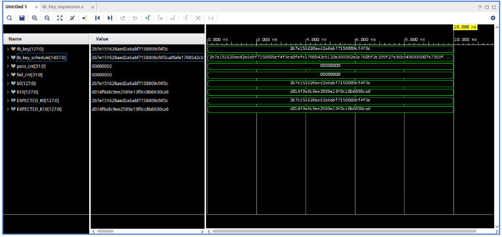
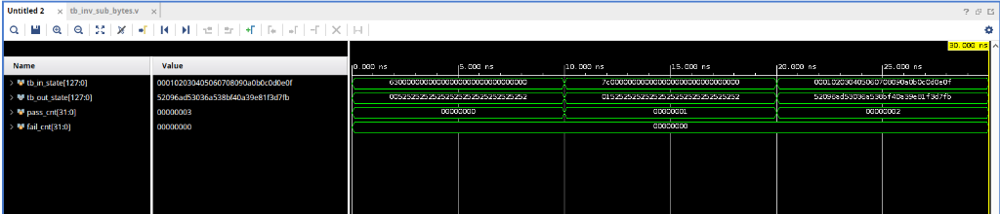
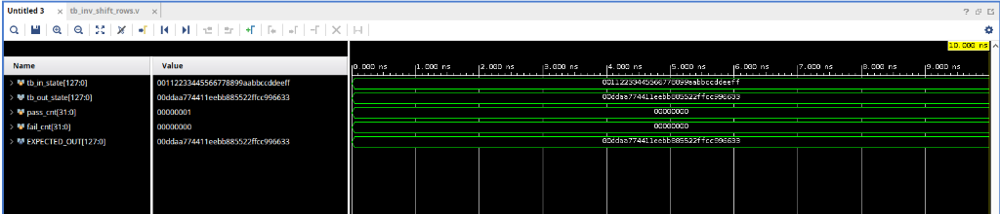
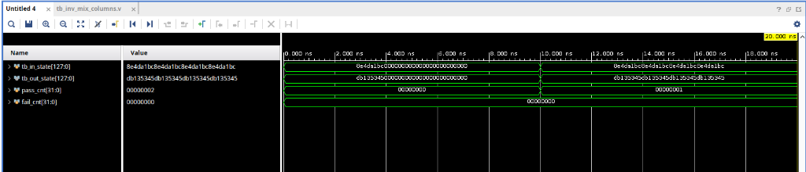
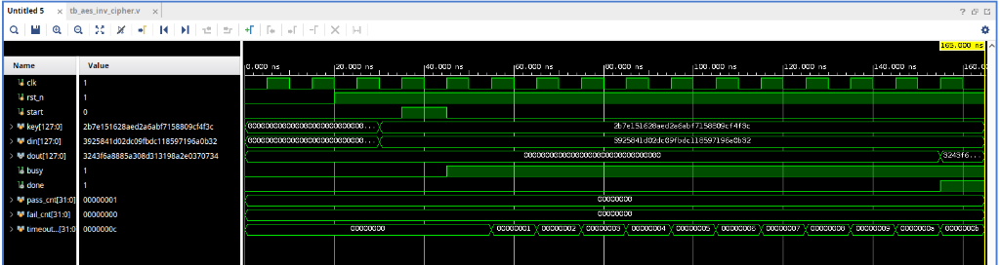

# AES-128 Decryption Core — Architecture, Working & Waveform Guide

**Group B | CDAC Project | FPGA / SoC Implementation**  
**Standard:** NIST FIPS-197 Standard Inverse Cipher  

---

## 1. Introduction & Overview

The **AES-128 Decryption Core** reverses the 128-bit encryption process, transforming a 128-bit ciphertext block back into its original 128-bit plaintext using a 128-bit secret key.

### Key Specifications:
* **Cipher Block Size:** 128 bits (16 bytes arranged in a $4 \times 4$ column-major matrix).
* **Key Length:** 128 bits.
* **Number of Rounds:** 10 rounds.
* **Architecture Style:** **Iterative Looping** (1 physical round of hardware reused across clock cycles).
* **Clock Frequency:** 100 MHz.
* **Core Latency:** 11 clock cycles (110 ns) per 128-bit block.

---

## 2. How AES Decryption Works (The Principle)

Encryption scrambles plaintext by layering four operations across 10 rounds: `SubBytes`, `ShiftRows`, `MixColumns`, and `AddRoundKey`. 

To decrypt, we must **unwrap** the data in **exact reverse mathematical order**:

```
Ciphertext 
    │
    ▼
[Initial AddRoundKey with Key 10]
    │
    ▼
[Rounds 9 down to 1]  (Repeated 9 times via Feedback Loop):
    1. InvShiftRows     (Undo row transposition)
    2. InvSubBytes      (Undo S-Box substitution)
    3. AddRoundKey      (XOR with Round Key K9 down to K1)
    4. InvMixColumns    (Undo GF(2^8) column mixing)
    │
    ▼
[Final Round (Round 0)]:
    1. InvShiftRows     (Undo row transposition)
    2. InvSubBytes      (Undo S-Box substitution)
    3. AddRoundKey      (XOR with Master Key K0)
    *(InvMixColumns is skipped because encryption omitted MixColumns in Round 10)*
    │
    ▼
Plaintext
```

### The 4 Core Operations Explained Simply:
1. **InvShiftRows (`inv_shift_rows.v`):** Cyclically shifts the rows of the $4 \times 4$ byte state to the **right** (Row 0 by 0, Row 1 by 1, Row 2 by 2, Row 3 by 3 bytes). Implemented purely through wire routing (**0 LUTs**).
2. **InvSubBytes (`inv_sub_bytes.v`):** Replaces each of the 16 bytes using the Inverse S-Box lookup table ($S^{-1}$). Undoes the non-linear confusion step.
3. **AddRoundKey:** Performs a bitwise XOR ($\oplus$) between the 128-bit state and the corresponding 128-bit round key.
4. **InvMixColumns (`inv_mix_columns.v`):** Multiplies each 4-byte column by the inverse AES matrix over Galois Field $\text{GF}(2^8)$ using constants `{0E, 0B, 0D, 09}`. Undoes the intra-column diffusion.
5. **Key Expansion (`key_expansion.v`):** Expands the 128-bit master key into all **11 round keys** ($K_0$ to $K_{10}$, total 1408 bits) simultaneously in combinational logic.

---

## 3. Top-Level Control & Datapath Architecture

```
                          128-bit Ciphertext (din)
                                     │
                                     ▼
                        +--------------------------+
                        |   Initial AddRoundKey    |<── Round Key 10 (K10)
                        |       (Bitwise XOR)      |
                        +------------+-------------+
                                     │
                  +──────────────────+<───────────────────+
                  │                  │                    │
                  │                  ▼                    │
                  │     +--------------------------+      │
                  │     |       InvShiftRows       |      │
                  │     | (Cyclic row right-shift) |      │
                  │     +------------+-------------+      │
                  │                  │                    │
                  │                  ▼                    │
                  │     +--------------------------+      │
                  │     |       InvSubBytes        |      │
                  │     | (16 x Inverse S-Box LUT) |      │
                  │     +------------+-------------+      │
                  │                  │                    │
                  │                  ▼                    │
                  │     +--------------------------+      │
                  │     |       AddRoundKey        |<── Round Key K[i]
                  │     |       (Bitwise XOR)      |    (K9 down to K1)
                  │     +------------+-------------+      │
                  │                  │                    │
                  │                  ▼                    │
                  │     +--------------------------+      │
                  │     |      InvMixColumns       |      │
                  │     |   (GF(2^8) Matrix Mult)  |      │
                  │     +------------+-------------+      │
                  │                  │                    │
                  │                  +────────────────────+
                  │               (Rounds 9 down to 1)
                  │
                  │ [Final Round]: Skip InvMixColumns
                  ▼
       +--------------------------+
       |   Final AddRoundKey      |<── Round Key 0 (K0)
       |       (Bitwise XOR)      |
       +------------+-------------+
                    │
                    ▼
          128-bit Plaintext (dout)
```

---

## 4. Waveform Analysis & Simulation Results

All unit modules and the top-level integration core have been thoroughly simulated and verified against **NIST FIPS-197** standard test vectors.

---

### Waveform 1: Key Expansion (`tb_key_expansion.v`)



#### How It Works:
The `key_expansion` module takes the 128-bit cipher key and derives the 44 words (1408 bits) of the AES key schedule. In decryption, we need the round keys in reverse order ($K_{10}$ first, $K_0$ last).

#### Waveform Signals Explained:
* **`tb_key[127:0]`** = `2b7e151628aed2a6abf7158809cf4f3c`: The standard NIST master key input.
* **`tb_key_schedule[1407:0]`**: The 1408-bit bus containing all 11 round keys generated in parallel.
* **`k0[127:0]`** = `2b7e151628aed2a6abf7158809cf4f3c`: Sliced Round Key 0. Matches `EXPECTED_K0` (the master key itself).
* **`k10[127:0]`** = `d014f9a8c9ee2589e13f0cc8b6630ca6`: Sliced Round Key 10. Matches `EXPECTED_K10` as published in NIST Appendix A.
* **`pass_cnt`** = `2`, **`fail_cnt`** = `0`: Confirms both keys are mathematically exact.
* **Observation:** Because the logic is combinational, the entire key schedule is computed at $t = 0\,\text{ns}$ without consuming clock cycles.

---

### Waveform 2: Inverse SubBytes (`tb_inv_sub_bytes.v`)



#### How It Works:
Replaces every byte in the 128-bit state with its multiplicative inverse mapping using 16 parallel lookup tables.

#### Waveform Signals Explained:
* **Test Case 1 ($0 - 10\,\text{ns}$):**
  * Input: `63000000000000000000000000000000` (Byte 0 is `0x63`).
  * Output: Byte 0 becomes `0x00` (since $S^{-1}(0\text{x}63) = 0\text{x}00$). `pass_cnt = 1`.
* **Test Case 2 ($10 - 20\,\text{ns}$):**
  * Input: `7c000000000000000000000000000000` (Byte 0 is `0x7C`).
  * Output: Byte 0 becomes `0x01` (since $S^{-1}(0\text{x}7C) = 0\text{x}01$). `pass_cnt = 2`.
* **Test Case 3 ($20 - 30\,\text{ns}$):**
  * Input: `000102030405060708090a0b0c0d0e0f` (16 distinct ascending bytes).
  * Output: `52096ad53036a538bf40a39e81f3d7fb` (16 mapped inverse bytes).
  * `pass_cnt` reaches `3`, `fail_cnt = 0`.
* **Observation:** Demonstrates that all 16 bytes are converted simultaneously in a single step.

---

### Waveform 3: Inverse ShiftRows (`tb_inv_shift_rows.v`)



#### How It Works:
Performs cyclic right rotations on the $4 \times 4$ byte grid to reverse the column distribution performed during encryption.

#### Waveform Signals Explained:
* **`tb_in_state[127:0]`** = `00112233445566778899aabbccddeeff`: Input matrix.
* **`tb_out_state[127:0]`** = `00ddaa774411eebb885522ffcc996633`: Output after cyclic right row shifts:
  * Row 0 (`00, 44, 88, cc`): unshifted.
  * Row 1 (`11, 55, 99, dd`): shifted right by 1 $\rightarrow$ `dd, 11, 55, 99`.
  * Row 2 (`22, 66, aa, ee`): shifted right by 2 $\rightarrow$ `aa, ee, 22, 66`.
  * Row 3 (`33, 77, bb, ff`): shifted right by 3 $\rightarrow$ `77, bb, ff, 33`.
* **`EXPECTED_OUT[127:0]`**: Hardcoded golden reference matching NIST FIPS-197.
* **`pass_cnt`** = `1`, **`fail_cnt`** = `0`: Verified with 0 logic gate overhead.

---

### Waveform 4: Inverse MixColumns (`tb_inv_mix_columns.v`)



#### How It Works:
Multiplies each 4-byte column by the inverse matrix over $\text{GF}(2^8)$ with reduction polynomial $0\text{x}11B$.

#### Waveform Signals Explained:
* **Test Case 1 ($0 - 10\,\text{ns}$ — Single Column):**
  * Input: `8e4da1bc000000000000000000000000` (Column 0 = `[8E, 4D, A1, BC]`).
  * Output: `db135345000000000000000000000000` (Column 0 = `[DB, 13, 53, 45]`).
  * Matches NIST Section 5.3.3 worked example. `pass_cnt = 1`.
* **Test Case 2 ($10 - 20\,\text{ns}$ — All 4 Columns in Parallel):**
  * Input: `8e4da1bc` repeated across all 4 columns.
  * Output: `db135345` repeated across all 4 columns.
  * `pass_cnt` increments to `2`, `fail_cnt = 0`.
* **Observation:** Confirms all 4 columns are evaluated independently and concurrently.

---

### Waveform 5: Top-Level AES Decryption Core (`tb_aes_inv_cipher.v`)



#### How It Works:
Demonstrates the full end-to-end decryption sequence managed by the 5-state FSM (`IDLE` $\rightarrow$ `KEY_EXP` $\rightarrow$ `ROUND` $\rightarrow$ `FINAL` $\rightarrow$ `DONE`).

#### Waveform Chronology & Signal Flow:
1. **$0 - 20\,\text{ns}$ (Reset):** `rst_n = 0`. The FSM initializes in `STATE_IDLE`. All registers are cleared.
2. **$20\,\text{ns}$:** `rst_n` goes HIGH (released). The core is armed.
3. **$35 - 45\,\text{ns}$ (Start Trigger):** `start` pulses HIGH for **1 clock cycle**. The core samples:
   * `key` = `2b7e151628aed2a6abf7158809cf4f3c`
   * `din` (Ciphertext) = `3925841d02dc09fbdc118597196a0b32`
4. **$45\,\text{ns}$:** `busy` goes HIGH. The core enters active computation.
5. **$45 - 155\,\text{ns}$ (11 Clock Cycles Computation):**
   * `timeout_cnt` steps from `0x01` to `0x0B` (11 cycles).
   * **Cycle 1 (`KEY_EXP`):** Performs initial $din \oplus K_{10}$.
   * **Cycles 2–10 (`ROUND`):** Executes 9 full rounds using the feedback datapath with keys $K_9$ down to $K_1$.
   * **Cycle 11 (`FINAL`):** Bypasses `InvMixColumns`, performs $sub\_out \oplus K_0$, and prepares `dout`.
6. **$155\,\text{ns}$ (Done & Output):**
   * `done` pulses HIGH for exactly 1 clock cycle.
   * `busy` drops to 0.
   * `dout` outputs: **`3243f6a8885a308d313198a2e0370734`** (The exact NIST Appendix B Plaintext).
7. **`pass_cnt`** = `1`, **`fail_cnt`** = `0`: Full decryption cycle completely verified.

---

## 5. Summary of Files in this Repository

| File Name | Role | Type |
|:---|:---|:---|
| `aes_inv_cipher.v` | Top-level AES-128 Decryption Core with 5-State FSM | RTL Design |
| `inv_shift_rows.v` | Cyclic row right-shifting (0, 1, 2, 3 bytes) | RTL Design |
| `inv_sub_bytes.v` | 16-byte parallel inverse S-Box lookup table | RTL Design |
| `inv_mix_columns.v` | $\text{GF}(2^8)$ matrix multiplication using xtime shifts | RTL Design |
| `key_expansion.v` | 1408-bit parallel 11-round key schedule generator | RTL Design |
| `tb_aes_inv_cipher.v` | Top-level integration testbench (FIPS Appendix B) | Testbench |
| `tb_inv_shift_rows.v` | Unit testbench for `inv_shift_rows` | Testbench |
| `tb_inv_sub_bytes.v` | Unit testbench for `inv_sub_bytes` | Testbench |
| `tb_inv_mix_columns.v` | Unit testbench for `inv_mix_columns` | Testbench |
| `tb_key_expansion.v` | Unit testbench for `key_expansion` | Testbench |
| `tb_loopback_verify.v` | Cross-verification testbench decrypting Group A output | Testbench |
| `docs_images/*.png` | Waveform captures embedded in documentation | Documentation |

---

*Group B — AES-128 Decryption Core | CDAC Project | October 2026*
